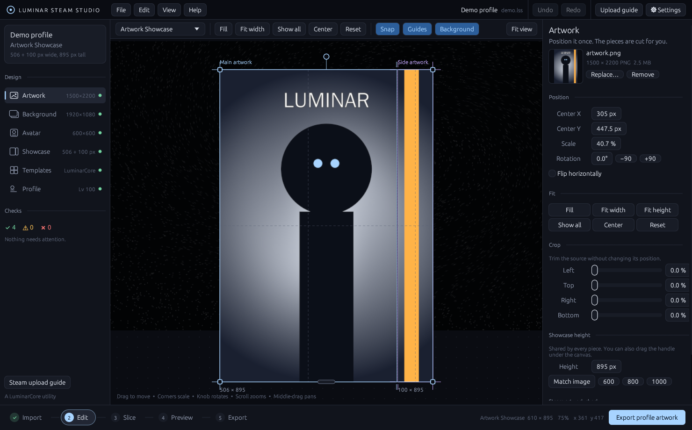

# Luminar Steam Studio

*Design once. Let the tool handle Steam.* A LuminarCore utility.

A native desktop app for designing Steam profile artwork. Import one image, position it on a
Steam-aware canvas, preview it on a simulated profile, and export every piece Steam needs, cut,
named and aligned.



Free application, made by **JGB_SPARK7** at **LuminarCore**: https://github.com/jgbSpark7.
Version, credits and third-party licences are in the app's **Info** tab (sidebar, or Help → About).

## Privacy

Works fully offline. Artwork is processed on your computer and never uploaded by the app. There's
no account, no telemetry and no Steam login: uploading happens on Steam's own website. Details,
and the developer release checklist, are in [`docs/RELEASE_CHECKLIST.md`](docs/RELEASE_CHECKLIST.md).

## Build and run

Requires Rust 1.80 or newer (https://rustup.rs).

```sh
cargo run --release
```

The release binary lands in `target/release/`. For the Windows `.exe`, its runtime
requirements and the installer, see [`docs/BUILDING_WINDOWS.md`](docs/BUILDING_WINDOWS.md). It's a single portable executable; on Windows it
runs without a console window. Passing a `.lss` path as the first argument opens that project,
which is what file associations use.

The first build compiles eframe and its graphics stack and takes a few minutes; later builds take
seconds. Dependencies are optimised even in debug builds (see `Cargo.toml`) because unoptimised
image decoding is painfully slow.

Linux: works under X11 or Wayland. File dialogs use the XDG desktop portal.

```sh
cargo test    # geometry, slicing alignment, config and project round-trip tests
```

## Workflow

1. **Import.** Drop artwork (plus an optional profile background and avatar). The showcase height
   is set to the image's own proportions, and the artwork is fitted to cover every piece.
2. **Edit.** Drag to move, drag corners to scale, drag the knob to rotate. Drag the handle under
   the canvas to change the showcase height. Snapping to edges and centres is on by default
   (hold Alt to bypass). The faded image shows what falls outside the pieces; the hatched strip is
   the gap Steam leaves between them.
3. **Slice.** See each output file exactly as it will be saved, with a guide that follows the
   pointer across every piece.
4. **Preview.** Your art on a simulated profile: header, avatar, level, showcase and side column.
5. **Export.** Writes `MainArtwork.png`, `SideArtwork.png` (or `FeaturedArtwork.png`),
   `Avatar.png`, `Preview.png` and `Project.lss` into a folder, optionally zipped, then re-reads
   every file to verify its dimensions.

The **Steam upload guide** (top bar) walks through uploading on Steam's own website with buttons
for each page. The app never asks for, sees or stores Steam credentials.

## How alignment is guaranteed

All design happens in one *composition space* measured in Steam display pixels. The Artwork
Showcase's main piece spans x 0–506 and the side piece x 510–610. The artwork has a single
transform in that space. Each export piece is rendered directly from the full-resolution source
through that same transform, so pieces line up by construction rather than by crop arithmetic.

Exports use **whole-number scale factors only** (Auto, 1×–4×). Steam rescales each piece to its
slot width; with an integer factor, every piece maps back to exactly the same display height.
Auto picks the highest factor your source image genuinely supports.

## Steam's dimensions live in one file

Every Steam-specific number (layout regions, profile proportions, avatar size, upload URLs, the
tall-artwork console snippet) is in [`src/steam/steam_config.json`](src/steam/steam_config.json).

If Steam changes something, you don't need to rebuild: **Settings → Create editable copy** writes
`steam_config.json` next to the executable, which overrides the built-in copy. Edit it, then
press **Reload**. Invalid files are ignored with a plain-language warning.

New showcase layouts are added the same way, by adding an entry to `layouts`.

### Assumptions to verify

- **Main/side gap = 4 px.** Steam doesn't document this. Pixels in the gap are never shown, so a
  small error only affects how continuous the art looks across it. Calibrate against a real
  profile by adjusting the side region's `x`.
- **Profile page proportions** are approximate. They drive the preview only, never the exported
  pieces.
- **The console snippet** for tall artwork is a long-standing community workaround, not an
  official feature. Steam can break it.
- **Profile backgrounds can't be uploaded.** They come from the Points Shop or Market. The
  background here is for previewing and lining art up; the app says so in its checks.

## Project layout

```
src/
  main.rs              window setup
  about.rs             app identity, creator/studio, privacy facts, third-party credits
  errors.rs            UserError: every message a user sees
  app/                 state, Action command layer, snapshot undo/redo, settings
  steam/               config loading, layouts, profile geometry, validation, steam_config.json
  project/             data model, transform/fit geometry, .lss save/load (relative paths)
  assets/              background image decoding, texture cache, animation probing
  export/              multi-threaded CPU renderer, slicer, export pipeline + ZIP
  editor/              canvas interaction, snapping guides, painting helpers
  templates/           10 style/layout presets
  ui/                  panels, preview mockup, dialogs, theme
```

Rendering and geometry (`project/transform.rs`, `export/`) have no UI dependencies beyond the
`emath` vector types, so the editor, validation and export all share identical maths.

## Current limits and next steps

- Animated GIF/WebP sources are detected; only the first frame is exported. Frame-accurate export
  slots into `assets/animation.rs` and the slicer, which already renders per piece.
- Single artwork layer. Text layers, effects and filters would become additional `Placement`s in
  the renderer.
- App identity and credits live in `src/about.rs`. The version comes only from `Cargo.toml`.
- Not yet built: Steam profile import from a public URL, recent-project thumbnails, a template
  library, localisation.
